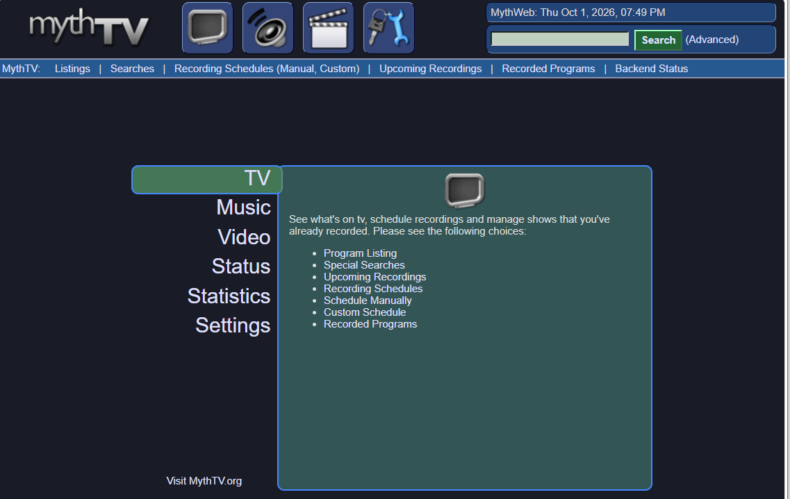

# MythWeb-Reborn

**MythWeb-Reborn** is a updated fork of [MythWeb](https://wiki.mythtv.org/wiki/MythWeb), designed to bring updated web access to your MythTV setup. It allows you to view TV listings, schedule recordings etc from a browser.

---

## ✨ Features

- **Modern PHP Support:**
- **Password Protection:**
- **Modern, Responsive EPG:**
- **Mobile Support:**
- **Improved Codebase**

---

## 📷 Preview

## 🚀 Getting Started

### Installation
Visit the [MythTV Wiki Page](https://wiki.mythtv.org/wiki/MythWeb).

### Qucik Start Installation
sudo apt update  
sudo apt install apache2  
sudo apt install php-mythtv  
git clone https://github.com/arobro/MythWeb-Reborn.git  

#### Move site
sudo cp -r MythWeb-Reborn/mythweb /var/www/html/mythweb

#### Set Apache user (www-data) as owner
sudo chown -R www-data:www-data /var/www/html/mythweb  
sudo chmod -R 755 /var/www/html/mythweb

#### Copy configuration to sites-available
sudo cp /var/www/html/mythweb/mythweb.conf.apache /etc/apache2/sites-available/mythweb.conf

#### Edit database password and path settings
sudo gedit /etc/apache2/sites-available/mythweb.conf

#### Restart
sudo a2enmod rewrite env  
sudo a2ensite mythweb.conf  
sudo systemctl restart apache2  

Open http://127.0.0.1/mythweb and setup password.

---

## 📜 License

MythWeb-Reborn is distributed under the terms of the **GNU General Public License version 2 (GPL-2.0)**. Where explicitly noted with the `@license` tag, code may be licensed under the **GNU Lesser General Public License version 2 (LGPL-2.0)**.

See the [LICENSE](LICENSE) file or visit [gnu.org/licenses](https://www.gnu.org/licenses/old-licenses/gpl-2.0.html) for specific license terms.
